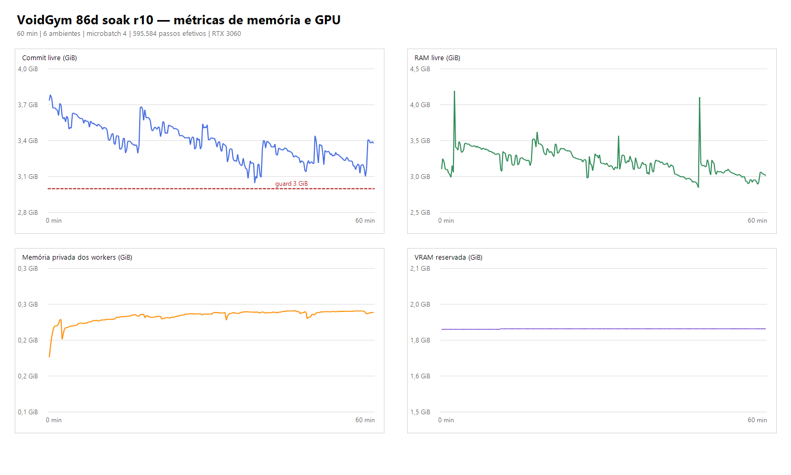

# 86d — estabilidade do pré-treino v2

**Resultado:** soak de uma hora concluído sem falha, com retomada do checkpoint final validada em uma execução curta. **A campanha longa não foi iniciada.**

## Execução e resultado

- Campanha diagnóstica: `pretrain-86d-soak-r10`, em `E:\VoidGymRuntime\v2\pretrain\pretrain-86d-soak-r10`.
- Início: 28/10/2026 22:26:33; conclusão: 23:26:38 (UTC−3); duração medida pelo supervisor: 3.604,7 s.
- Checkpoint de partida: `universal-004460288`. Final: **5.055.872 passos totais**, ou **595.584 passos efetivos** sobre o checkpoint inicial. Velocidade média: **165,4 passos/s** (mínimo do commit livre permaneceu acima de 3 GiB; guard configurado em 3 GiB).
- Seis ambientes, CUDA, batch efetivo 2.048, microbatch 4 e acumulação de gradiente em 16 microbatches. A avaliação rápida consumiu 60,3 s no total (~1,7% do tempo medido).
- Não houve queda nem aviso de OOM nos logs do lançador/supervisor. O processo encerrou `COMPLETED` por fim normal do limite de uma hora.

## Memória, workers e GPU

Séries de `phase_profile.csv` ao longo dos 60 minutos:

- Commit livre: mínimo **3,047 GiB**, máximo 3,784 GiB e 3,378 GiB no encerramento. O limite de segurança de 3 GiB foi respeitado, com margem mínima estreita de 47 MiB.
- RAM livre: mínimo **2,847 GiB** e 3,015 GiB no encerramento.
- Memória privada agregada dos workers: 0,226 GiB na primeira amostra, máximo 0,291 GiB e 0,289 GiB na última. A oscilação ficou limitada; não repetiu o crescimento observado no r9, que chegou a aproximadamente 0,74 GiB em seis workers antes de o guard interromper o teste.
- Todos os seis workers registraram `torch_imported=false`. O teste automático de spawn sem Torch também passou.
- VRAM: pico de **1.036 MiB alocados** e **1.892 MiB reservados**. As atualizações usaram microbatches com acumulação, mantendo o batch efetivo de 2.048.

## Diagnóstico e correção

A revisão do r9 revelou caches de renderização indexados por sementes únicas de episódio (`_static_effects`, `_background_frame` e `sample_style`) com limites altos. A memória privada agregada dos workers crescia durante aquela execução. Os limites dos caches foram reduzidos para 64, 128 e 256 entradas, respectivamente, com teste que percorre 100 sementes e verifica que permanecem limitados. No r10, a memória agregada de workers ficou abaixo de 0,30 GiB durante todo o soak. Isso sustenta os caches como causa provável do crescimento anterior; não prova que expliquem isoladamente a violação de acesso observada no 86c.

O r10 registra a falha do r9 por guard de commit, não por crash nativo: o commit livre chegou a ~2,99 GiB após cerca de 20 min. O evento original do 86c (`VCRUNTIME140`/violação de acesso e avisos de alocação CUDA) não se repetiu no r10. O diagnóstico do crash original permanece provável, não conclusivo.

## Checkpoint e retomada

O r10 gravou checkpoints em intervalos de ~100 mil passos, incluindo `universal-005055872`. O manifesto e todos os arquivos de pesos/otimizador estavam presentes e não vazios. O teste separado `pretrain-86d-resume-verify` carregou esse checkpoint, avançou para 5.060.096 passos e encerrou `COMPLETED`; gerou `universal-005060096`. Os seis workers dessa retomada também registraram `torch_imported=false`.

## Ambiente e validações

- Windows 11, Python 3.12.10, PyTorch 2.14.1+cu132 (build CUDA 13.2), NVIDIA RTX 3060 / driver 617.14, NumPy 2.5.3, Pillow 12.3.0, Stable-Baselines3 2.9.0.
- O arquivo de paginação foi detectado como **gerenciado automaticamente**, total de 18 GiB no início do teste. Não foi alterado.
- Runtime completo: 851 testes aprovados, 4 ignorados, 3 avisos e 8 subtestes; Ruff e mypy passaram. A suíte foi executada após a correção dos caches.
- Testes do supervisor cobrem retomada após encerramento forçado e falha após três encerramentos. `git diff --check` passou, com aviso apenas de normalização CRLF em `recurrent_ppo.py`.
- `src/hk_agent/` não faz parte desta alteração.

## Limite da conclusão

O soak satisfaz os critérios operacionais de uma hora, sem crash, ≥150 passos/s, sem OOM registrado, pelo menos um checkpoint e retomada confirmada. O commit mínimo ficou muito próximo do guard de 3 GiB; portanto, estes dados validam esta configuração de seis ambientes neste computador, mas não justificam extrapolar para uma campanha de 24 horas sem acompanhamento. A campanha longa segue sem iniciar.

