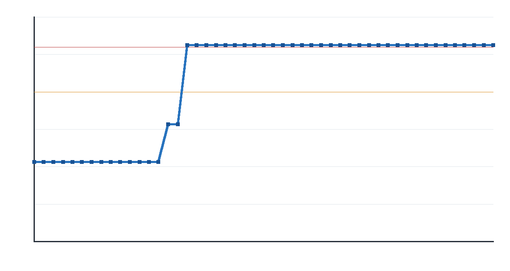

# Prompt 87 — comparação v1/v2 (baseline parcial)

**Estado:** campanha `v2-hk-1` iniciada em 25/10/2026 às 14:43 BRT, com duração configurada de 6 h e dois atores. O ponto escolhido foi `Tutorial_01`, o início reproduzível disponível na baseline v1 e na cópia isolada; não foi usado o save pessoal nem o save da campanha v1. O pré-treino universal foi carregado de `universal-000697088` (697.088 passos prévios). Ajuda humana está ligada com gatilho de 10 travadas/60 min; nenhum pedido apareceu no primeiro check.

**ID técnico:** `explore-20261025-143813-86dc`, versão 1. Runtime em `E:\VoidGymRuntime\shared\explore-20261025-143813-86dc`.

**Recuperação de inicialização:** a primeira tentativa revelou que as DLLs antigas das duas instâncias não anunciavam `semantic_labels_v1`; os atores falharam sem coletar rollouts. A campanha foi parada cooperativamente, e o bridge Release local foi implantado apenas nas cópias gerenciadas, com backups em `C:\VoidGym\artifacts\bridge-deploy-backups\bridge-20261025-144334-038dfcf4`. SHA-256 implantado: `02006742e7b19bd3aeda4a6228c1741f9aefdc1553a50e7e2c01a43a4cdc2768`. A mesma especificação foi relançada às 14:43 BRT; o teste da primeira tentativa não conta para os dados da comparação.

**Primeiro check após a correção:** dois atores e learner em `RUNNING`; os logs mostram gameplay em `Tutorial_01`. Rollouts dos dois atores começaram a ser escritos em E:. O learner ainda não havia concluído a primeira atualização no instante deste registro. RAM livre observada após o início: cerca de 2,9 GB. A automação de monitoramento foi configurada para avisar em falha, falta de progresso por 10 min ou encerramento, ficando silenciosa enquanto o estado for normal.

## Linha de base v1 observada

Fonte: `C:\Users\thayr\Games\HollowKnight-AI\runtime\shared\jogada-1-repeat-1c3b\manifest.json`, `journey\campaign-progress.json`, `evaluations.jsonl` e `learner.json`.

| Métrica | Evidência disponível |
|---|---|
| Área observada | `Tutorial_01`; sem troca de cena registrada |
| Progresso máximo | 131,37 unidades em `Tutorial_01` |
| Primeiro registro ≥100 u | episódio 15, progresso 131,37 u |
| Primeiro registro ≥130 u | episódio 15, progresso 131,37 u |
| Saída da cena inicial | não registrada |
| Episódios encerrados como `stuck` | 46 episódios encerrados como `stuck` entre 51 resumos no manifesto; 4,11 por hora de intervalo total (11,19 h, inclui pausas/falhas) |
| Passos/rodadas | 146.944 passos, 155 rodadas |
| Duração do intervalo | 20/10/2026 13:03 a 21/10/2026 00:14 (BRT), 11,19 h; soma de `training_seconds` do learner: 2.284 s (38,1 min) |
| Retorno estocástico | 1 avaliação registrada no manifesto: retorno -0,667, 1.000 passos, progresso máximo 57,08 u |
| Encerramento | manifesto `CANCELLED`, checkpoint final R155; `learner.json` indica expiração de heartbeat e o manifesto registra `OSError: [Errno 28] No space left on device` |

O checkpoint declarado `round-00000155.zip` existe e passou na verificação estrutural CRC do ZIP. “Progresso” é a métrica geométrica da cena `Tutorial_01`, não progresso na Passagem do Rei.

O gráfico usa o máximo acumulado entre os 49 resumos que têm progresso numérico, em ordem do manifesto. Não é possível reconstruir uma curva honesta por hora: não há timestamps de cada resumo e o intervalo contém interrupções; apenas 38,1 minutos são contabilizados como atualização do learner. Há somente uma avaliação estocástica, insuficiente para resumir um conjunto de 75.

## Próxima etapa bloqueada

Não iniciar `v2-hk-1` até alinhar o cenário. Opção recomendada: usar `Tutorial_01`, o ponto real e reproduzível da v1, com cópia isolada da baseline. A outra opção é preparar uma baseline nova na Passagem do Rei e redefinir a comparação. A campanha v1 permanece intacta e parada.

